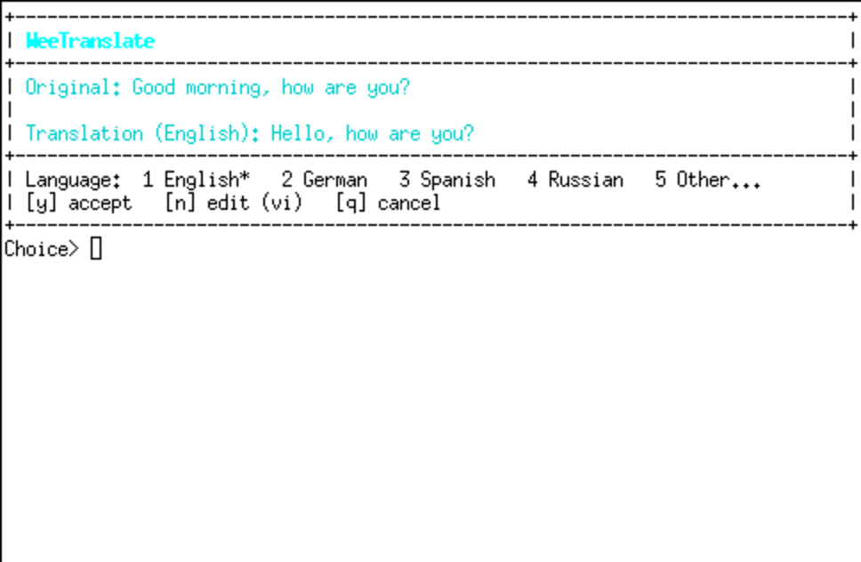

# WeeTranslate

**Version 0.5.1** · BSD-3-Clause

A small WeeChat plugin that translates text, lets you review or edit it in a
separate window, and puts the result in the input bar.

> **Vibecoded like a pig.** Generated with DeepSeek `deepseek-flash` through
> DeepSeek Harness `0.2.2-rc.1`. No production guarantees, no support promises.



## Features

- `/trad <text>`: translate to English, German, Spanish and Russian in one
  LLM call.
- Popup with the original, the translation and a language selector:
  `1` English, `2` German, `3` Spanish, `4` Russian, `5` Other.
- `5` opens a free-form language field; the plugin calls the LLM again for
  that language and reopens the popup.
- English by default, configurable with `default_language`.
- Edit with `$VISUAL`, then `$EDITOR`, otherwise `vi`.
- The accepted translation goes into the input bar, ready for Enter.
- Nothing is sent automatically.
- No translation chatter in the channel; errors go to the core buffer.
- DeepSeek by default, OpenAI or any compatible endpoint.
- `/trad config` opens the native `fset` menu.
- Works with X11 terminals, or `tmux` when explicitly selected.
- POSIX installer, no bash required.

## Requirements

- WeeChat >= 4.1 with Python and URL/curl support.
- Python 3.
- An API key for the selected provider.
- A popup terminal: an X11 terminal (`xterm`, `kitty`, `alacritty`, ...), or
  `tmux >= 3.2` with `terminal=tmux`.
- An editor: `$VISUAL`/`$EDITOR`, or `vi`/`vim`/`nano`.

## Install

From the repository:

```sh
git clone https://github.com/lateralux/weetranslate.git
cd weetranslate
./install.sh
```

Or from a release archive:

```sh
tar xzf weetranslate-0.5.1.tar.gz
cd weetranslate-0.5.1
./install.sh
```

This copies both scripts to `~/.local/share/weechat/python/` and creates the
autoload symlink. Keep them together: the plugin locates the helper beside the
installed script. If WeeChat uses a custom data directory:

```sh
WEECHAT_HOME=/path/to/weechat ./install.sh
```

Restart WeeChat or load the plugin:

```text
/python load ~/.local/share/weechat/python/weetranslate.py
```

On FreeBSD:

```sh
pkg install weechat python3
# only if you use terminal=tmux:
pkg install tmux
# only if you use an X11 terminal:
# pkg install xterm
```

Check `/plugin list` for the Python plugin and `/version` for WeeChat >= 4.1.

## Configure

```text
/set weetranslate.main.provider deepseek
/set weetranslate.main.api_key sk-...
/set weetranslate.main.default_language en
/set weetranslate.main.editor auto
/set weetranslate.main.terminal auto
```

For `/secure`:

```text
/secure set llm_key sk-...
/set weetranslate.main.api_key ${sec.data.llm_key}
```

| Option | Default | Meaning |
|---|---|---|
| `provider` | `deepseek` | `deepseek`, `openai`, `custom` |
| `api_key` | *(empty)* | Provider key, or `${sec.data.xxx}` |
| `api_url` | *(empty)* | chat/completions URL; empty = provider default |
| `model` | *(empty)* | Model; empty = provider default |
| `source_language` | `auto` | Source language, `auto` to detect |
| `default_language` | `en` | Initial popup language: `en`, `de`, `es`, `ru` |
| `editor` | `auto` | `$VISUAL`, `$EDITOR`, then `vi` |
| `terminal` | `auto` | X11 terminal; `tmux` is an explicit choice |
| `terminal_cmd` | *(empty)* | Custom terminal command when `terminal=custom` |
| `timeout` | `30` | API timeout in seconds |
| `max_chars` | `2000` | Maximum source length |
| `show_original` | `on` | Show the source text in the popup |
| `debug` | `off` | Debug messages in the core buffer |
| `keep_temp` | `off` | Keep temporary files |

### Providers

DeepSeek:

```text
/set weetranslate.main.provider deepseek
/set weetranslate.main.api_key sk-...
```

OpenAI:

```text
/set weetranslate.main.provider openai
/set weetranslate.main.api_key sk-...
```

Compatible endpoint:

```text
/set weetranslate.main.provider custom
/set weetranslate.main.api_url https://example.com/v1/chat/completions
/set weetranslate.main.model my-model
/set weetranslate.main.api_key ...
```

### tmux

`terminal=auto` looks for an X11 terminal and does **not** choose tmux.
For SSH/tmux without X11:

```text
/set weetranslate.main.terminal tmux
```

The plugin then runs `tmux display-popup -E`. The popup has focus; use the keys
below.

## Usage

```text
/trad Hello, how are you?
```

In the popup:

| Key | Action |
|---|---|
| `1` / `2` / `3` / `4` | English / German / Spanish / Russian, no new API call |
| `5` | Enter a custom language name; the plugin translates again |
| `y` or Enter | Accept the displayed translation |
| `n` or `e` | Edit the displayed language |
| `q` or Escape | Cancel |
| close the window | Accept the displayed translation |

Commands:

```text
/trad <text>       translate
/trad -- <text>    translate text that looks like a subcommand
/trad config       open the fset menu
/trad config show  print the effective configuration
/trad cancel       cancel pending translations
/trad help         show help
```

The result is inserted into the input bar of the source buffer. Nothing is
sent. The cursor is placed at the end of the line.

## Notes

- A translation starting with `/` gets a leading space so it cannot be executed
  as a WeeChat command.
- If you type while the popup is open, your input is not overwritten; the
  translation is shown in the core buffer instead.
- The popup is a separate terminal. It cannot run in a plain WeeChat buffer.
- This is a POC: no streaming, no conversation context, no multiline input,
  no automatic sending.

## Authors

- **DeepSeek** — model.
- **Vincent Bonnevialle (@lateralux)** — design, prompting, whip.

See [AUTHORS](AUTHORS).

## License

BSD-3-Clause. See [LICENSE](LICENSE).
